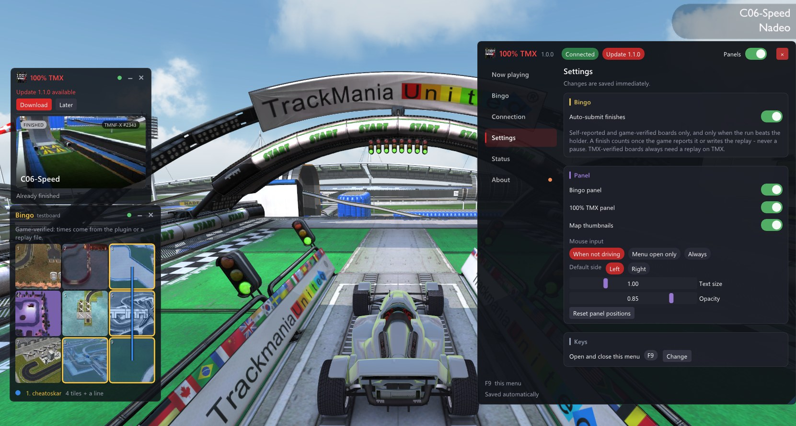
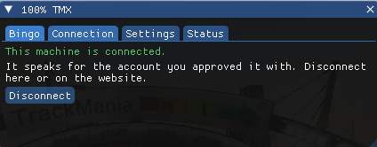
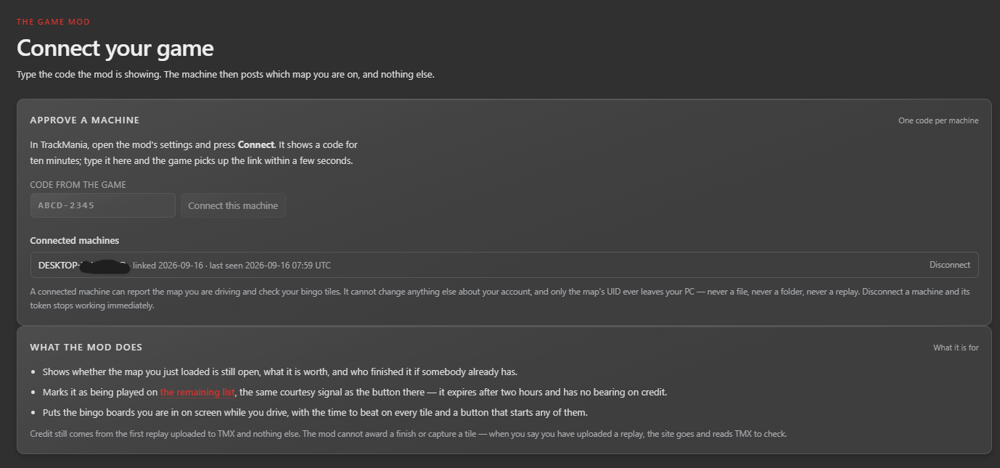
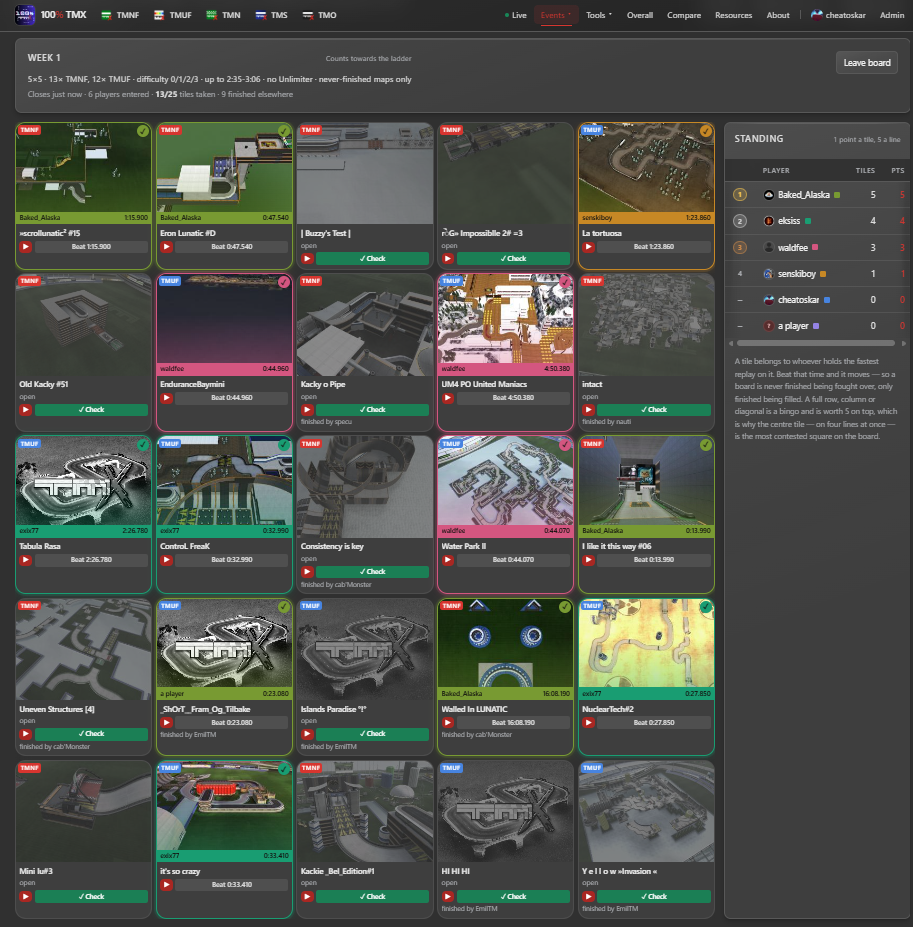
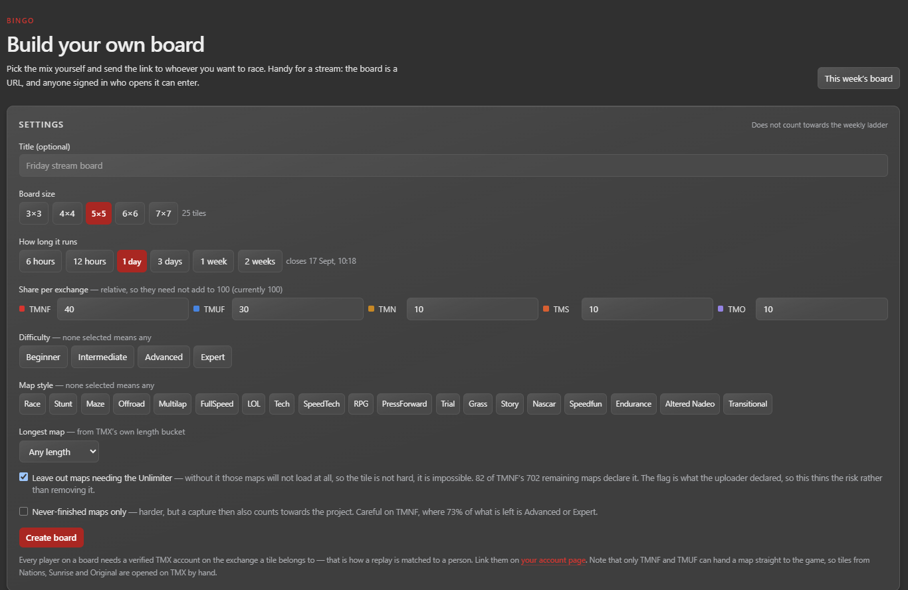
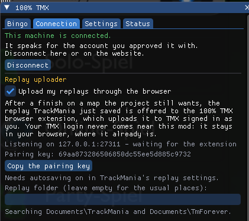
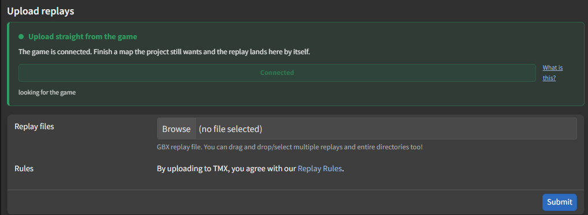
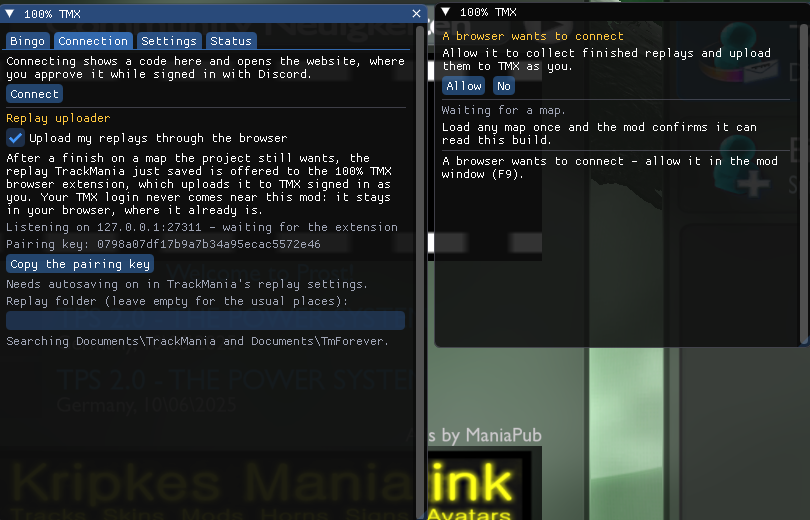

# 100% TMX + Bingo

An overlay for TrackMania Nations Forever and United Forever. It shows
[100tmx.com](https://100tmx.com) bingo boards in the game, and tells you whether
the map you're on has ever been finished on TMX and what it's worth to the
100% TMX project.

You don't need to care about the 100% project to use it. Make a bingo board,
send the link to a few friends, and race them for the evening.



**[Download](../../releases/latest)** · [100tmx.com](https://100tmx.com) ·
[Bingo boards](https://100tmx.com/events/bingo)

## Quick start

1. Install the [TrackMania ModLoader](https://tomashu.dev/software/tmloader/).
2. Add the mod's update server to the ModLoader, see
   [Install with ModLoader](#install-with-modloader-recommended-auto-updates)
   (or download `100TMX.zip` from [Releases](../../releases/latest), extract it
   and run `100TMX-Installer.exe`).
3. Open the ModLoader, tick **100% TMX + Bingo** and start the game.
4. Press **F9 → Connection → Connect** and approve the code on the page that
   opens.
5. Join a board on [100tmx.com/events/bingo](https://100tmx.com/events/bingo),
   pick it on the **Bingo** page in game, and drive.

## Installing

### Install with ModLoader (recommended, auto-updates)

The ModLoader downloads the mod itself and installs every new version on its
own. Nothing to download, nothing to run.

1. Close the ModLoader completely, including the tray icon.
2. Open `%LOCALAPPDATA%\TMLoader\config.yaml` with Notepad (paste the path into
   the Explorer address bar).
3. Add this line under `servers:`, with two spaces in front like the lines
   already there, and save:

   ```yaml
   servers:
     # ... the servers that are already there ...
     - 'https://cheatoskar.github.io/100-TMX-Bingo-Plugin/modloader/'
   ```

4. Start the ModLoader. **100% TMX + Bingo** appears in its list; pick it, tick
   it in your profile and start the game.

New versions then arrive through the ModLoader's auto update (*Auto Update* in
its settings). A copy installed earlier with the installer lives in the same
folder (`products\100% TMX + Bingo\<version>`); the ModLoader keeps it and adds
newer versions next to it. Old versions can be removed in the ModLoader.

### With the installer or by hand

The zip contains the installer, a `README.txt` (English and German) and the
`100% TMX + Bingo` folder. The installer does nothing but copy that folder into
the ModLoader.

If you'd rather not run the installer, copy the folder yourself into
`%LOCALAPPDATA%\TMLoader\database\TmForever\products` (paste that into the
Explorer address bar). If an older version is already there, let Windows merge
the folders.

**Updating:** with the update server above, nothing to do. Otherwise the mod
tells you when a new version is out (also under
**About**). Install it the same way, then close the ModLoader completely,
including the tray icon, and start it again. It only picks up new versions on
startup.

**Removing:** `100TMX-Installer.exe /uninstall`, or delete the folder.

Windows Defender sometimes complains about the installer because it isn't
code-signed. In that case copy the folder by hand. Each release lists SHA-256
hashes if you want to check the download
(`Get-FileHash .\100TMX.zip -Algorithm SHA256`).

<details>
<summary>What's in the folder</summary>

The ModLoader keeps a product database rather than a mods folder, with one
subfolder per version:

```
products\
  100% TMX + Bingo\
    description.yaml
    1.1.0\
      description.yaml
      100TMX.dll
```

The folder is built by [`install-modloader.ps1`](install-modloader.ps1), which
can also install straight from a DLL:

```powershell
powershell -ExecutionPolicy Bypass -File install-modloader.ps1 -Dll .\100TMX.dll -Version 1.1.0
```

Nothing else is touched: no registry, no game folder, no startup entry.
</details>

<details>
<summary>Without the ModLoader (ASI loader)</summary>

1. Get `100TMX.asi` from [Releases](../../releases/latest) and the 32-bit
   [Ultimate ASI Loader](https://github.com/ThirteenAG/Ultimate-ASI-Loader) as
   `binkw32.dll`.
2. In the TrackMania folder, rename the existing `binkw32.dll` to
   `binkw32Hooked.dll` and put the loader's `binkw32.dll` in its place.
3. Put `100TMX.asi` next to `TmForever.exe` and start the game.
</details>

## Connecting

There's no browser in TrackMania, so the mod shows a short code and you approve
it on the website instead.



1. Press **F9**, go to **Connection** and press **Connect**.
2. Your browser opens [100tmx.com/link](https://100tmx.com/link) and the game
   shows a code like `ABCD-2345`.
3. Sign in with Discord, enter the code and confirm.



Any TMX accounts you've linked on the website come along automatically. You can
disconnect from the mod or from the website at any time.

The token is kept in `Documents\100TMX\config.ini`, encrypted for your Windows
account, so copying the file to another PC doesn't work. On Windows 7 you need
update KB3140245 (TLS 1.2).

## Bingo

A board is a grid of TMX maps. Drive a map to take its tile; if someone is
faster, they take it from you. Full rows, columns and diagonals score extra.

1. Someone makes a board at
   [100tmx.com/events/bingo/new](https://100tmx.com/events/bingo/new) and sends
   the link around. There's also a weekly board anyone can join.
2. Everyone opens the link, signs in with Discord and presses **Enter**.
3. In game, pick the board on the **Bingo** page.
4. Click a tile and press **Play this map** to load it.

Your friends don't need the mod, the board works in the browser too.

| The board on the website | Making your own |
|---|---|
|  |  |

### How tiles are checked

The person who makes the board decides:

| Setting | With the mod |
|---|---|
| A replay driven for this board | Upload the replay to TMX, then press **Verify replay** |
| Any replay on TMX | Same, but older replays count too |
| No check | Your time goes on the tile when you finish, or type one with **Enter time...** |
| Plugin and replay only | Your time goes on the tile when you finish, no typed times |

The first two need your TMX account linked on the website
([how](https://100tmx.com/guide/accounts)).

On the last two, the mod submits your time the moment you cross the line, as
long as it beats the current holder. Pausing at a checkpoint doesn't count as a
finish. You can turn this off under **Settings → Auto-submit finishes**. Other
players see the change within about 20 seconds.

These times are self-reported. The mod is open source and nothing stops someone
from sending a fake time, so these boards are for playing with people you
trust.

## The 100% TMX panel

For the map you're on it shows whether it's still unfinished on TMX (and who
finished it if not), how many points it's worth, and whether it's on the
exclusion list. If someone finishes it while you're driving, you'll see that
too.

With **Share what I am playing** on, the website marks the map as being played,
so two people don't grind the same map by accident.

## Uploading replays

TMX has no upload API, so the mod hands your autosaved replays to the
[TMX Universal Track Downloader](https://github.com/cheatoskar/TMX-Downloader)
browser extension, which uploads them using your normal TMX login. The mod
never sees that login.

1. Install the extension.
2. In game: **F9 → Connection → Upload replays via browser extension**.

   

3. Open TMX's upload page and press connect in the extension's box.

   

4. The **100% TMX** panel asks whether to allow the browser. Press **Allow**;
   it's remembered.

   

Replay autosaving has to be on in TrackMania's settings. The game only saves a
run that beats your own best on that map, which is also all TMX accepts.
Maps that aren't on TMX are skipped. If your replays aren't in
`Documents\TrackMania` or `Documents\TmForever`, set the folder on the
Connection page.

## In game

**F9** opens the menu (change it under **Settings → Keys**). If you also use TM
Vibrant Shaders, avoid F6-F9, F11 and F12; Ctrl+F9 stays theirs.

There are two panels, **100% TMX** and **Bingo**. While you're driving, clicks
go through to the game. When you stop, pause or open the menu you can drag them
around and pull the bottom-right corner to change their width. **-** folds a
panel, **x** hides it (bring it back under **Settings**).

The menu has pages for the current map (including the TMX top 10), your bingo
boards, the connection, settings, a **Status** page that's useful for bug
reports, and **About**.

Settings are saved in `Documents\100TMX\config.ini`. Delete it to reset
everything.

## Privacy

Nothing is sent until you connect. After that the mod sends the ID of the map
you're on, what you do on bingo boards, and your finish time on self-reported
boards. Sharing what you play can be turned off. Replays go from your PC
through the browser extension to TMX, never to 100tmx.com.

The mod only reads the game's memory and never changes the game or its files.
It can't give you credit in the 100% project either: that only comes from
replays on TMX.

## Troubleshooting

**"This TrackMania build is not recognised."** The mod only reads builds it
knows. Open an issue with the build ID from the **Status** page, the game
(Nations or United) and how you start it.

<details>
<summary>Adding offsets for your build yourself</summary>

`config.ini` takes an `[offsets]` section, which is checked before it's used:

```ini
[offsets]
name = my-build
app = 0x972EB8
get_id_name = 0x5357D0
challenge = 0x198
race = 0x454
challenge_uid = 0xDC
challenge_name = 0x108
race_player_info = 0x330
player_info_player = 0x238
player_sub = 0x1C
player_state = 0x314
player_time = 0x2B0
```
</details>

**My time didn't go on the tile.** Check that the board is *No check* or
*Plugin and replay only*, that you beat the holder, and that auto-submit is on.

**I can't click the panels.** They ignore the mouse while you drive. Stop or
press **F9**.

**Anything else:** attach `Documents\100TMX\log.txt` to an
[issue](../../issues).

## Building

Visual Studio 2022 or newer (C++ workload) and CMake. 32-bit only, like the
game.

```bash
cmake -S . -B build -A Win32
cmake --build build --config Release
```

That gives you `100TMX.dll` and `100TMX-Installer.exe` in `build/Release`.
Dear ImGui is fetched by CMake. Pushing a `v*` tag builds a release with
[`RELEASE_NOTES.md`](RELEASE_NOTES.md) as its description.

### Releases and the ModLoader update server

Each release also carries `100TMX-ModLoader-server.zip`: the DLL alone, which
the ModLoader unpacks into `products\100% TMX + Bingo\<version>\`. After a
tag's release the job `modloader-server` rebuilds the update server on GitHub
Pages (branch `gh-pages`): `modloader/index.json` lists every release that
carries that zip and isn't a pre-release, `modloader/beta/index.json` all of
them, each with the zip's SHA-256 and the release notes as changelog. Product
name, description and dependencies come from `install-modloader.ps1`; the icon
is `images/icon.png`, served next to the index. Running the workflow by hand
rebuilds the server without a release.

- **One-time setup:** *Settings → Pages → Build and deployment → Deploy from a
  branch → `gh-pages`, `/ (root)`* (the branch exists after the first tag
  build). Until then the server URL answers 404.
- Releases from before the server have no `100TMX-ModLoader-server.zip` and
  aren't listed. The repository variable `MODLOADER_BACKFILL=1` makes the job
  add it to 1.0.0 and later from their own `100TMX.dll`; it changes published
  releases, so it's off by default.
- Check the format locally (no network):
  `python tools/modloader_server.py selftest` (uses `build/Release/100TMX.dll`
  if built; `--reference https://fullspeed.mooo.com/modloader/index.json`
  compares with a working server).

| File | |
|---|---|
| `dllmain.cpp` | starts the threads |
| `hook.cpp` | Direct3D 9 `EndScene`/`Reset` hook |
| `overlay.cpp` | panels and menu |
| `game.cpp` | reads map, race time, finish and speed from the game |
| `worker.cpp` | talks to the website, on its own thread |
| `bridge.cpp` | local connection for the browser extension |
| `config.cpp`, `log.cpp` | ini and log |
| `http.cpp`, `json.h` | WinHTTP and a small JSON reader |

How the finish is detected is in [`docs/finish-marker.md`](docs/finish-marker.md).

I built this with help from [Claude Code](https://claude.com/claude-code). The
ideas, design and testing are mine. Found a bug? Open an
[issue](../../issues).

## Credits

- [Dear ImGui](https://github.com/ocornut/imgui) (MIT)
- [Twinkie](https://github.com/flownyy/Twinkie) (MIT, Ahmad Saleh), for where
  TmForever keeps the current map
- [TMInterface](https://github.com/donadigo/TMInterfaceClientPython), for the
  layout of the player state

No code from Twinkie or TMInterface is included.

MIT licensed, see [LICENSE](LICENSE). If you add offsets for another TrackMania
build, a pull request is very welcome.
