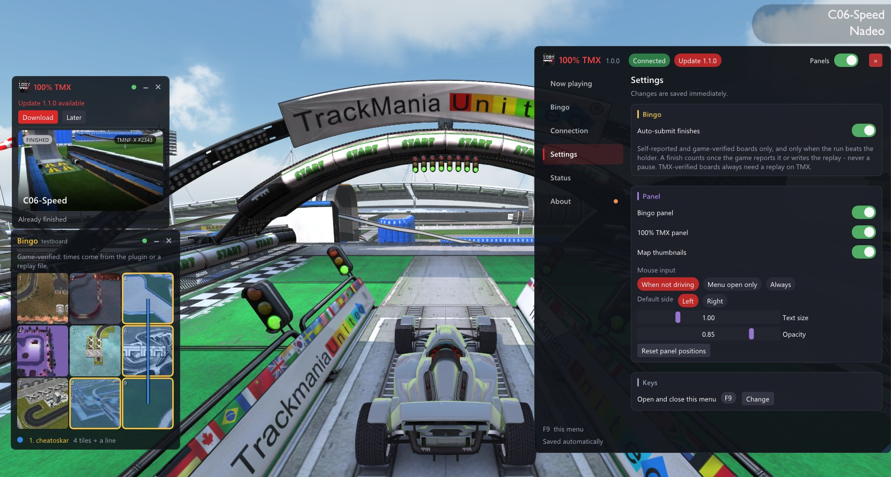

## 100 TMX Bingo Plugin 1.1.1

Bingo boards from [100tmx.com](https://100tmx.com) and the 100% TMX project status, right inside **TrackMania Nations & United Forever**.



---

### What's new

**New name.** The mod is now called **100 TMX Bingo Plugin** in the ModLoader and the installer. Nothing else changes: your settings, your ticked profiles and the updates stay as they are, because the mod's folder keeps its old name (`100% TMX + Bingo`).

The new look, the panels you can arrange, the TMX top 10 and the update notice came with [1.1.0](https://github.com/cheatoskar/100-TMX-Bingo-Plugin/releases/tag/v1.1.0).

---

### Install

**With the ModLoader, updates itself:** close the ModLoader (also the tray icon), open `%LOCALAPPDATA%\TMLoader\config.yaml` with Notepad and add this line under `servers:`:

```yaml
  - 'https://cheatoskar.github.io/100-TMX-Bingo-Plugin/modloader/'
```

Then tick *100 TMX Bingo Plugin* in your profile. New versions arrive on their own from then on.

**With the installer:** download `100TMX.zip`, extract it and run `100TMX-Installer.exe` (or copy the folder by hand, see `README.txt`).

**Coming from 1.0.0:** install as usual, then close the ModLoader completely (including the tray icon) and start it again. 1.0.0 can't tell you about updates, 1.1.0 and later can.

In the game `F9` opens the menu, and *Connection* → *Connect* links it to your 100tmx.com account. Step by step: [README](https://github.com/cheatoskar/100-TMX-Bingo-Plugin#readme).
